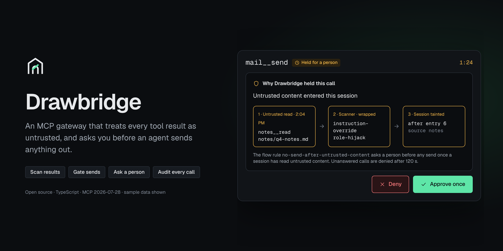
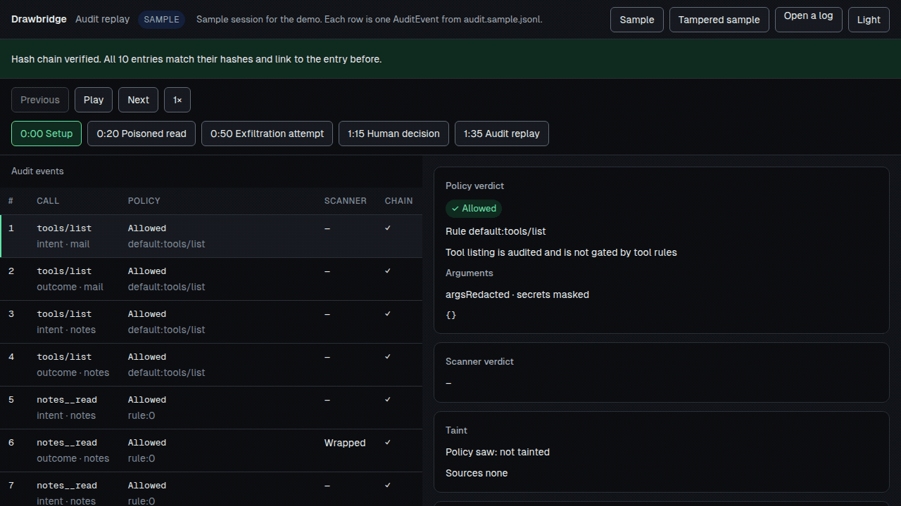
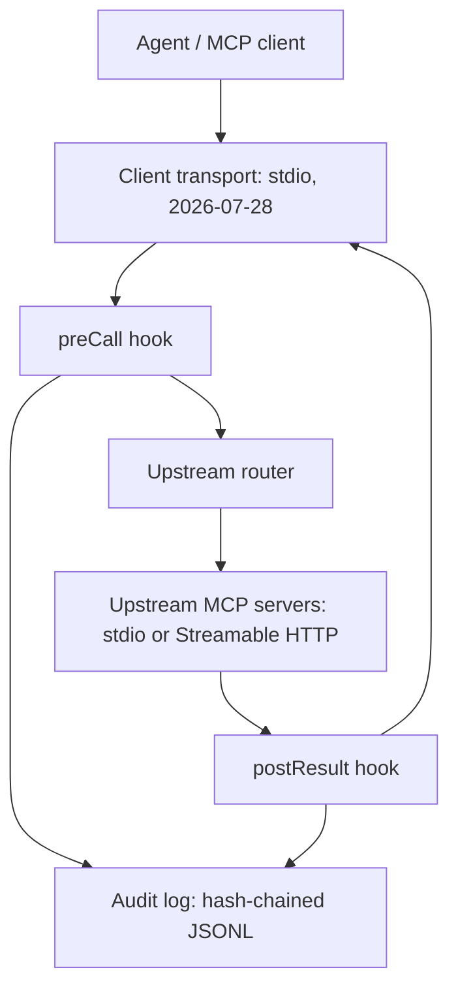

# Drawbridge

<p align="center">
  
</p>

Drawbridge is an MCP security gateway. An agent connects to it over stdio. Drawbridge connects to the upstream MCP servers you list, shows one namespaced tool catalog (`notes__read`), checks the call, and writes a hash-chained audit log before it forwards.

A confused note can tell the agent to send the keys. Drawbridge wraps that text, taints the session, and holds the send until a person decides. The decision and the hash chain are what you can show later.

The threat model is [docs/threat-model.md](docs/threat-model.md). The same log, checked again in the browser, is [site/replay/](site/replay/).

## Quickstart

Requires Node.js 22 and pnpm 10. Three commands:

```bash
pnpm install
pnpm build
pnpm demo
```

`pnpm demo` lists the demo tools, reads `q4-notes` (the result is wrapped and the session is tainted), reads `q4-roadmap`, and holds `mail__send`. On a terminal it prints the dashboard URL and waits. Without one, it denies the call and runs `audit verify`. The two-minute shot list is [docs/demo-script.md](docs/demo-script.md).



To serve the gateway yourself:

```bash
node packages/gateway/dist/cli.js serve --config examples/drawbridge.yaml
```

That process speaks MCP **2026-07-28** on stdio and spawns the demo notes and mail servers in `examples/demo-upstream`. A client sees `notes__read`, `notes__echo`, and `mail__send`. Logs go to stderr. Stdout is the protocol stream. The scanner runs in wrap mode: a hit string comes back between `<<untrusted>>` and `<<end untrusted>>`, the session is tainted, and the next `mail__send` is held.

A 2025 client that opens with `initialize` is rejected. Point a 2026-07-28 client at the command, or use the SDK the way the end-to-end test does (`versionNegotiation: { mode: { pin: "2026-07-28" } }`).

```json
{
  "mcpServers": {
    "drawbridge": {
      "command": "node",
      "args": ["/absolute/path/to/drawbridge/packages/gateway/dist/cli.js", "serve", "--config", "/absolute/path/to/drawbridge.yaml"]
    }
  }
}
```

After a session, check the log:

```bash
node packages/gateway/dist/cli.js audit verify --config examples/drawbridge.yaml
```

`audit verify` exits 0 when every line's hash matches its contents and its `prevHash` matches the previous line. It exits 1 after a rewrite, a reorder, or a line deleted from the middle of the chain.

## Configuration

`drawbridge.yaml` is YAML, checked with Zod. Drawbridge will not start if the file is invalid.

```yaml
version: 1
audit:
  path: ./drawbridge-audit.jsonl
defaults:
  action: deny
  fromAnnotations: true
rules:
  - tool: notes__read
    action: allow
    args:
      path:
        pattern: '^notes/.*\.md$'
        maxLength: 200
  - tool: notes__echo
    action: allow
  - tool: mail__send
    action: allow
flows:
  - name: no-send-after-untrusted-content
    when:
      sessionTainted: true
    tools: [mail__send, "*__http_post", "*__create_issue"]
    action: approve
    reason: Untrusted content entered this session
upstreams:
  notes:
    transport: stdio
    command: ["node", "examples/demo-upstream/dist/index.js"]
    trusted: false
    pinTools: false
  remote:
    transport: http
    url: http://127.0.0.1:3000/mcp
    secrets:
      Authorization: env:REMOTE_MCP_TOKEN
```

- Upstream names match `[A-Za-z0-9][A-Za-z0-9_-]*` and must not contain `__`. Tool `read` on upstream `notes` is advertised as `notes__read`. A tool whose own name contains `__` still round-trips.
- `${VAR}` is read from the gateway's environment for paths, commands, and URLs. An unset variable refuses startup. It is not how you pass a credential, and it is not the MCP client's credential.
- A credential is a `secrets` entry. That is the supported path. The value is `env:NAME` or `file:PATH`. An inline value refuses startup, and the error does not repeat it. Stdio secrets are injected into that process's environment. HTTP secrets are sent only as that upstream's headers. One upstream never receives another's secrets. A credential-shaped literal in `env` or `headers` (Authorization, a Bearer value, `*_TOKEN`, `*_KEY`, `*_SECRET`, or password) prints a startup warning and does not print the value.
- Stdio upstreams receive a short safe environment (`PATH`, `HOME`, and the other SDK defaults) plus the keys in `env` and `secrets`. The rest of the gateway's environment is not copied across.
- `auth` and `secretRef` still refuse startup. Client arguments named like a token or an authorization header are stripped before the forward and stored as `[REDACTED]`.
- `scanner.mode` is `block`, `warn`, or `wrap` (the example uses `wrap`). `approval.timeoutSeconds` sets `expiresAt` on a pending call (default 120). High-risk outbound tools skip in-client elicitation and wait on the dashboard or the CLI.
- `pinTools: true` requires `drawbridge pin --config <file>` first (default pin path `drawbridge.pins.json`). `drawbridge pin update --config <file>` rewrites it. A changed definition is denied, or held when `onPinMismatch` is `approve`.

Rules are first-match-wins, in file order. For `tools/call`:

1. Listing tools is always allowed and audited. Tool rules do not gate `tools/list`.
2. If the upstream sets `pinTools`, the current definition hash is checked before rules. A missing catalog entry, a failed list, a missing pin, or a hash mismatch is final.
3. The first matching tool glob wins. `*` is any sequence, `?` is one character, and the match is anchored. The rule id is `rule:<index>`.
4. On an allow or approve rule, argument constraints are checked. A violation denies with that same rule id. A deny rule does not check arguments.
5. If nothing matched, a trusted upstream with `defaults.fromAnnotations` uses `destructiveHint` as approve and otherwise `readOnlyHint` as allow. An untrusted server's annotations are ignored. A matching rule always wins over an annotation.
6. Otherwise `defaults.action` applies (deny when the section is omitted).
7. Flows run in file order. The first flow whose `when.sessionTainted` equals the current session and whose tool glob matches stops the scan. It can only tighten (`deny` over `approve` over `allow`). The demo leaves `mail__send` as allow with no `allowDomains`, so this flow is what holds that send once the session is tainted.
8. Rate limits apply only to an allow or approve. `rules[].rateLimit` is per tool. `defaults.rateLimit` is the whole session. `perMinute` is a 60 second window. A hit at t=0 does not count at t=60000.

Constraints are top-level argument keys (or every element of an array). `pattern` is a JavaScript regular expression. `enum` is an exact string match. `allowDomains` is the domain after the last `@`, compared case-insensitively and not as a subdomain. `maxLength` is the string length. A missing or non-string value denies. An invalid pattern refuses to load the config.

Session taint starts untainted. A tool result from an untrusted upstream marks it tainted, and so does a scanner hit. The normative audit rules, including the wrap delimiters, email masking, and scanner span indexes, are in [docs/audit-schema.md](docs/audit-schema.md).

## How a call moves



For `tools/call` the order is:

1. Split `upstream__tool`. An unknown name is denied and audited. Nothing is forwarded.
2. `PolicyEngine.preCall`. A throw is a deny. Only `allow` and `approved` continue. `approve` writes `approve_pending` (with `expiresAt`) and waits. A person approves or denies that one call from elicitation (when the client supports it and the tool is not high-risk), `drawbridge approvals`, or the local dashboard. A timeout writes `timeout`. The decision links with `approval.pendingId` and does not repeat scanner hits. An approval forwards once; the outcome's `intentId` is the decision id.
3. Append an intent record and fsync it. If that write fails, the call is denied and not forwarded.
4. Forward the raw arguments to that upstream. Drawbridge's own client identity is what the upstream sees.
5. `PolicyEngine.postResult`. A throw withholds the payload.
6. Append an outcome record with `resultHash`, `durationMs`, and `intentId` set to the intent record. If that write fails, the client gets an error and not the upstream payload.

`tools/list` does the same per upstream and returns one page. A failed upstream list fails the whole list, so the catalog is never silently partial. `ping` is answered locally by the SDK. Resources, prompts, and completions are not aggregated.

The gateway keeps a session id (a ULID) for the process. That is the stdio client's session. Records store the session taint policy evaluated. It starts untainted.

## Audit schema

`hash = sha256(prevHash + canonicalJson)` with no separator. `canonicalJson` is the canonical JSON of the event with only `hash` removed, so `prevHash` is both the raw prefix and a field inside the JSON. The first `prevHash` is 64 zero characters. Canonical JSON has no whitespace, object keys are sorted by UTF-16 code unit, `undefined` object entries are dropped, and `undefined` array entries become `null`. Verify re-parses each line, so on-disk key order does not matter. Opening a log that fails verification refuses to start.

`audit verify` and startup both use `auditEventSchema`. Optional `taintAfter` and `intentId` are part of that schema. The field path, span indexes, email mask, and the rule that decision lines do not repeat scanner hits are specified in [docs/audit-schema.md](docs/audit-schema.md).

Email local parts in stored arguments keep the domain: `john@outsidecorp.com` is stored as `j•••@outsidecorp.com`. Secret-shaped keys, `Bearer` tokens, and `sk-` tokens are still replaced with `[REDACTED]`.

## Repository

```
packages/core/        config schema, policy hooks, audit log
packages/gateway/     CLI, stdio server, upstream router
examples/demo-upstream/   notes server, and a local mail fixture (`node dist/index.js mail`)
examples/drawbridge.yaml
```

SDK packages, checked against npm for this milestone: `@modelcontextprotocol/server` and `@modelcontextprotocol/client` **2.4.0** (spec 2026-07-28). Tests host a Streamable HTTP fixture with `@modelcontextprotocol/node` **2.1.2**, which is the release published alongside server 2.4.0. Config validation uses Zod 4.

```bash
pnpm check                  # build, test, typecheck, lint, secret scan
pnpm attacks -- --check     # replay the scored sessions; a miss fails CI
```

## Attack results

Eight scripted sessions. The full scorecard is [docs/attack-results.md](docs/attack-results.md). `pnpm attacks` rewrites it, and CI checks the committed copy.

| Scenario | Expected | Actual | Result |
| --- | --- | --- | --- |
| Indirect prompt injection to exfiltration | fixture wrapped, then held and not sent | fixture wrapped, then held and not sent | pass |
| Direct prompt injection to exfiltration | argument echoed wrapped, then held and not sent | argument echoed wrapped, then held and not sent | pass |
| Tool-description poisoning | tool description wrapped | tool description wrapped | pass |
| Rug pull after the first tools/list | first call allowed, changed description denied | first call allowed, changed description denied | pass |
| Confused deputy (client credentials) | client credentials stripped and not forwarded | client credentials stripped and not forwarded | pass |
| Secret leakage | secret absent from audit, stderr, and dashboard | secret absent from audit, stderr, and dashboard | pass |
| Audit tampering | audit verify exits 1 | audit verify exits 1 | pass |
| Kill switch | new call denied while paused | new call denied while paused | pass |

Score: 8/8.

## Roadmap

| Milestone | Build |
| --- | --- |
| 1 | Pass-through proxy, namespaced catalog, write-ahead audit log |
| 2 | Policy engine: allow / deny / approve, argument rules, rate limits, tool pinning |
| 3 | Heuristic scanner, wrap / warn / block, session taint. The introducing event keeps the previous `taint` and sets `taintAfter` |
| 4 | Approvals: elicitation, `drawbridge approvals`, and a local dashboard. Send-after-taint flags untrusted data in outbound arguments. Approvals are once-only |
| 5 | Per-upstream secrets, no credential passthrough, kill switch, threat model |
| 6 | Attack suite, scored results, three-command demo, static audit replay. Draft notes: [docs/release-notes-v0.1.md](docs/release-notes-v0.1.md). Not tagged |
| Later | Optional classifier, HTTP client with OAuth, container sandbox, multi-agent identity |

Decisions for later milestones, not built here:

- Approvals in v0.1 are once-only. A decision names `approval.pendingId` and does not grant a later identical call.
- The demo policy has no `allowDomains` on `mail__send`. The no-send-after-untrusted flow rule is what holds that send for a person.
- The static audit replay is `site/replay/`. Serve the `site/` directory so the page and fonts stay on one origin. Hosting that directory on anthonysdigital.net is a later publish step. This draft is not a release tag.

## Security

Drawbridge's job is to keep a confused or compromised agent from using your tools and your credentials in ways you did not allow. The threat model names the assets, the trust boundaries, and the attacks this version does and does not claim to stop: prompt injection that leads to exfiltration, tool poisoning, rug-pull description changes, confused deputy, secret leakage, and audit tampering. Mitigations point at the code that implements them.

Read [docs/threat-model.md](docs/threat-model.md) before you point Drawbridge at a credential or an untrusted server.

`drawbridge pause --config <file>` writes `drawbridge-pause.json` next to the audit log, then tells the running gateway to deny every new tool call and auto-deny calls that are already waiting. If it cannot reach that gateway, it exits nonzero and does not report success. The gateway re-reads the file before every call, so a pause written during startup still denies the next call. `drawbridge resume` clears it. The dashboard control does the same thing. A restart stays paused until resume.

## Known gaps

- High-risk outbound tools (`*__send`, `*__http_post`, `*__create_issue`) skip in-client elicitation. They wait on the same `tools/call` for the CLI or the dashboard. A client that only supports elicitation must retry a non-high-risk approval; the dashboard does not complete that round by itself.
- The local dashboard binds to `127.0.0.1`, uses a random per-run token, and serves no remote assets. `drawbridge approvals url` prints the address. The read-only replay is `site/replay/` and does not call the network.
- A tool result from an untrusted upstream taints the session, and so does a scanner hit. The demo flow then holds `mail__send`. Trusted results with no hit do not taint. `scanner.classifier` other than `off` refuses startup; only the heuristics run.
- In `block` mode the client does not receive the payload. Hit spans for that verdict index the withheld text. `warn` keeps the text (`flagged`). `wrap` returns the text between `<<untrusted>>` and `<<end untrusted>>`, each on its own line (`wrapped`), and spans index that wrapped text.
- `secretRef` / `auth` still refuse startup. Use `secrets` with `env:` or `file:` instead.
- `tools/list` is audited and is not gated by tool rules.
- `resources/*`, `prompts/*`, and completions are not forwarded. `tools/list` is a single page; a cursor is ignored.
- Icons and other tool fields beyond title, description, input and output schemas, and annotations are not advertised.
- The audit store is JSONL only. The replay reads a log you already have. The local dashboard is the approval UI, not a log browser.
- Redaction is a small set of key names and patterns.
- If the outcome record cannot be written, the client does not receive the payload. An upstream side effect may already have happened.
- The official SDK's stdio client probes `server/discover` on a short-lived extra process. That probe starts a gateway process, which connects upstreams and then exits. Client-facing legacy `initialize` support is a later milestone.
- CI runs `pnpm check` and `pnpm attacks -- --check`. MCP Inspector runs and release provenance are not wired up yet. The v0.1 notes are a draft and this commit is not tagged.

Copyright 2026 Anthony. Licensed under the Apache License, Version 2.0. See [LICENSE](LICENSE).
