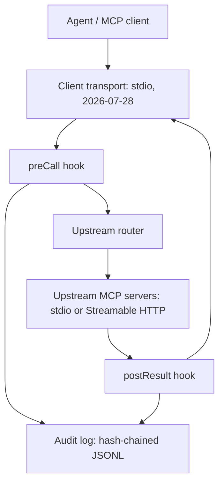

# Drawbridge

Drawbridge is an MCP security gateway. An agent connects to it over stdio. Drawbridge connects to the upstream MCP servers you list, shows one namespaced tool catalog (`notes__read`), and writes a hash-chained audit log before it forwards a call.

This repository is milestone 1: a pass-through proxy with a validated config and a tamper-evident log. Allow, deny, and approval rules are hook points only. They are not enforced yet, and a config that contains them is refused so they cannot look like protection.

## Quickstart

Requires Node.js 22 and pnpm 10.

```bash
pnpm install
pnpm build
node packages/gateway/dist/cli.js serve --config examples/drawbridge.yaml
```

That process speaks MCP **2026-07-28** on stdio and spawns the demo notes server in `examples/demo-upstream`. A client sees `notes__read` and `notes__echo`. Logs go to stderr. Stdout is the protocol stream.

A 2025 client that opens with `initialize` is rejected. Point a 2026-07-28 client at the command, or use the SDK the way the end-to-end test does (`versionNegotiation: { mode: { pin: "2026-07-28" } }`).

```json
{
  "mcpServers": {
    "drawbridge": {
      "command": "node",
      "args": ["/absolute/path/to/drawbridge/packages/gateway/dist/cli.js", "serve", "--config", "/absolute/path/to/drawbridge.yaml"]
    }
  }
}
```

After a session, check the log:

```bash
node packages/gateway/dist/cli.js audit verify --config examples/drawbridge.yaml
```

`audit verify` exits 0 when every line's hash matches its contents and its `prevHash` matches the previous line. It exits 1 after a rewrite, a reorder, or a line deleted from the middle of the chain.

## Configuration

`drawbridge.yaml` is YAML, checked with Zod. Drawbridge will not start if the file is invalid.

```yaml
version: 1
audit:
  path: ./drawbridge-audit.jsonl
upstreams:
  notes:
    transport: stdio
    command: ["node", "examples/demo-upstream/dist/index.js"]
    trusted: false
  remote:
    transport: http
    url: http://127.0.0.1:3000/mcp
    headers:
      Authorization: ${REMOTE_MCP_TOKEN}
```

- Upstream names match `[A-Za-z0-9][A-Za-z0-9_-]*` and must not contain `__`. Tool `read` on upstream `notes` is advertised as `notes__read`. A tool whose own name contains `__` still round-trips.
- `${VAR}` is read from the gateway's environment. An unset variable refuses startup. The value is not the MCP client's credential.
- Stdio upstreams receive a short safe environment (`PATH`, `HOME`, and the other SDK defaults) plus the keys in `env`. The rest of the gateway's environment is not copied across.
- `trusted` is stored and passed into the policy hook. It does not change behavior in this milestone.
- `pinTools: true`, `auth`, `secretRef`, and the policy sections `defaults`, `rules`, `flows`, `scanner`, and `approval` refuse startup. Those behaviors land in later milestones.

## How a call moves



For `tools/call` the order is:

1. Split `upstream__tool`. An unknown name is denied and audited. Nothing is forwarded.
2. `PolicyEngine.preCall`. A throw is a deny. Only `allow` and `approved` continue. The milestone 1 engine is `AllowAllPolicy`.
3. Append an intent record and fsync it. If that write fails, the call is denied and not forwarded.
4. Forward the raw arguments to that upstream. Drawbridge's own client identity is what the upstream sees.
5. `PolicyEngine.postResult`. A throw withholds the payload.
6. Append an outcome record with `resultHash` and `durationMs`. If that write fails, the client gets an error and not the upstream payload.

`tools/list` does the same per upstream and returns one page. A failed upstream list fails the whole list, so the catalog is never silently partial. `ping` is answered locally by the SDK. Resources, prompts, and completions are not aggregated.

The gateway keeps a session id (a ULID) for the process. That is the stdio client's session. Taint is recorded as untainted until the scanner milestone.

## Audit record

Each line is one JSON object. The hash is SHA-256 of the canonical JSON of every field except `hash`. The first record's `prevHash` is 64 zeroes.

```ts
interface AuditEvent {
  id: string;                 // ULID
  ts: string;                 // ISO 8601 UTC
  sessionId: string;
  client: { name?: string; version?: string };
  upstream: string;
  method: "tools/call" | "tools/list" | "resources/read" | "prompts/get";
  tool?: string;
  argsRedacted: unknown;
  argsHash: string;           // sha256 of the raw arguments
  decision: "allow" | "deny" | "approve_pending" | "approved" | "denied_by_human" | "timeout";
  ruleId?: string;
  reason?: string;
  taint: { tainted: boolean; sources: string[] };
  scanner?: { verdict: "clean" | "flagged" | "wrapped"; hits: { rule: string; span: [number, number] }[] };
  approval?: { channel: "elicitation" | "dashboard" | "cli"; by?: string; latencyMs: number };
  resultHash?: string;        // present on the outcome record
  durationMs?: number;
  prevHash: string;
  hash: string;
}
```

An allowed call is two lines: intent, then outcome. A denial is one line. `argsRedacted` masks values whose keys look like secrets, plus email addresses, `Bearer` tokens, and `sk-` tokens in strings. `argsHash` covers the raw arguments, which are not stored. This is not the heuristic scanner.

Opening an existing log that fails verification refuses to start.

## Repository

```
packages/core/        config schema, policy hooks, audit log
packages/gateway/     CLI, stdio server, upstream router
examples/demo-upstream/   notes server used by the example and the tests
examples/drawbridge.yaml
```

SDK packages, checked against npm for this milestone: `@modelcontextprotocol/server` and `@modelcontextprotocol/client` **2.4.0** (spec 2026-07-28). Tests host a Streamable HTTP fixture with `@modelcontextprotocol/node` **2.1.2**, which is the release published alongside server 2.4.0. Config validation uses Zod 4.

```bash
pnpm check    # build, test, typecheck, lint, secret scan
```

## Roadmap

| Milestone | Build |
| --- | --- |
| 1 (this PR) | Pass-through proxy, namespaced catalog, write-ahead audit log |
| 2 | Policy engine: allow / deny / approve, argument rules, rate limits, tool pinning |
| 3 | Heuristic scanner, wrap / warn / block, session taint |
| 4 | Approvals (elicitation, CLI, dashboard) and send-after-taint rules |
| 5 | Per-upstream secrets, no credential passthrough, kill switch, threat model |
| 6 | Attack suite, scored results, v0.1 release |
| Later | Optional classifier, HTTP client with OAuth, container sandbox, multi-agent identity |

## Known gaps

- Policy, pinning, scanning, taint, and approvals are interfaces only. `AllowAllPolicy` allows every routed tool and records `ruleId: stub:allow-all`.
- `resources/*`, `prompts/*`, and completions are not forwarded. `tools/list` is a single page; a cursor is ignored.
- Icons and other tool fields beyond title, description, input and output schemas, and annotations are not advertised.
- The audit store is JSONL only. The SQLite index, dashboard, and `replay` command come with the dashboard.
- Redaction is a small set of key names and patterns.
- If the outcome record cannot be written, the client does not receive the payload. An upstream side effect may already have happened.
- The official SDK's stdio client probes `server/discover` on a short-lived extra process. That probe starts a gateway process, which connects upstreams and then exits. Client-facing legacy `initialize` support is a later milestone.
- CI runs typecheck, unit and end-to-end tests, lint, and a secret scan. The attack suite and MCP Inspector runs are milestone 6. Release provenance is not wired up yet.

Copyright 2026 Anthony. Licensed under the Apache License, Version 2.0. See [LICENSE](LICENSE).
