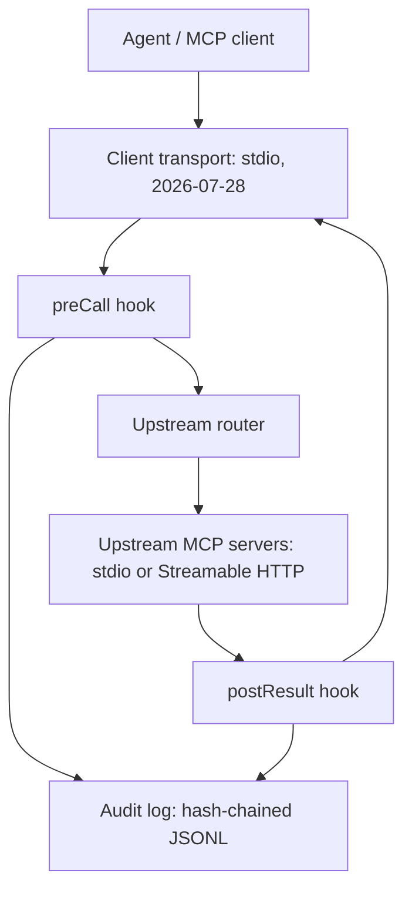

# Drawbridge

Drawbridge is an MCP security gateway. An agent connects to it over stdio. Drawbridge connects to the upstream MCP servers you list, shows one namespaced tool catalog (`notes__read`), and writes a hash-chained audit log before it forwards a call.

This repository enforces the milestone 2 policy engine on top of the pass-through proxy: allow, deny, and approve rules, argument checks, rate limits, flow rules, and tool pins. Scanning and approval channels are accepted in the config and are not enforced yet. An approve decision is written as pending and then denied until those channels exist.

## Quickstart

Requires Node.js 22 and pnpm 10.

```bash
pnpm install
pnpm build
node packages/gateway/dist/cli.js serve --config examples/drawbridge.yaml
```

That process speaks MCP **2026-07-28** on stdio and spawns the demo notes server in `examples/demo-upstream`. A client sees `notes__read` and `notes__echo`. Logs go to stderr. Stdout is the protocol stream.

A 2025 client that opens with `initialize` is rejected. Point a 2026-07-28 client at the command, or use the SDK the way the end-to-end test does (`versionNegotiation: { mode: { pin: "2026-07-28" } }`).

```json
{
  "mcpServers": {
    "drawbridge": {
      "command": "node",
      "args": ["/absolute/path/to/drawbridge/packages/gateway/dist/cli.js", "serve", "--config", "/absolute/path/to/drawbridge.yaml"]
    }
  }
}
```

After a session, check the log:

```bash
node packages/gateway/dist/cli.js audit verify --config examples/drawbridge.yaml
```

`audit verify` exits 0 when every line's hash matches its contents and its `prevHash` matches the previous line. It exits 1 after a rewrite, a reorder, or a line deleted from the middle of the chain.

## Configuration

`drawbridge.yaml` is YAML, checked with Zod. Drawbridge will not start if the file is invalid.

```yaml
version: 1
audit:
  path: ./drawbridge-audit.jsonl
defaults:
  action: deny
  fromAnnotations: true
rules:
  - tool: notes__read
    action: allow
    args:
      path:
        pattern: '^notes/.*\.md$'
        maxLength: 200
  - tool: notes__echo
    action: allow
  - tool: mail__send
    action: allow
flows:
  - name: no-send-after-untrusted-content
    when:
      sessionTainted: true
    tools: [mail__send, "*__http_post", "*__create_issue"]
    action: approve
    reason: Untrusted content entered this session
upstreams:
  notes:
    transport: stdio
    command: ["node", "examples/demo-upstream/dist/index.js"]
    trusted: false
    pinTools: false
  remote:
    transport: http
    url: http://127.0.0.1:3000/mcp
    headers:
      Authorization: ${REMOTE_MCP_TOKEN}
```

- Upstream names match `[A-Za-z0-9][A-Za-z0-9_-]*` and must not contain `__`. Tool `read` on upstream `notes` is advertised as `notes__read`. A tool whose own name contains `__` still round-trips.
- `${VAR}` is read from the gateway's environment. An unset variable refuses startup. The value is not the MCP client's credential.
- Stdio upstreams receive a short safe environment (`PATH`, `HOME`, and the other SDK defaults) plus the keys in `env`. The rest of the gateway's environment is not copied across.
- `auth` and `secretRef` still refuse startup. Per-upstream secrets are milestone 5.
- `scanner` and `approval` are validated. `approval.timeoutSeconds` sets `expiresAt` on a pending call (default 120). Channels, `highRisk`, and the scanner are not applied yet.
- `pinTools: true` requires `drawbridge pin --config <file>` first (default pin path `drawbridge.pins.json`). `drawbridge pin update --config <file>` rewrites it. A changed definition is denied, or held when `onPinMismatch` is `approve`.

Rules are first-match-wins, in file order. For `tools/call`:

1. Listing tools is always allowed and audited. Tool rules do not gate `tools/list`.
2. If the upstream sets `pinTools`, the current definition hash is checked before rules. A missing catalog entry, a failed list, a missing pin, or a hash mismatch is final.
3. The first matching tool glob wins. `*` is any sequence, `?` is one character, and the match is anchored. The rule id is `rule:<index>`.
4. On an allow or approve rule, argument constraints are checked. A violation denies with that same rule id. A deny rule does not check arguments.
5. If nothing matched, a trusted upstream with `defaults.fromAnnotations` uses `destructiveHint` as approve and otherwise `readOnlyHint` as allow. An untrusted server's annotations are ignored. A matching rule always wins over an annotation.
6. Otherwise `defaults.action` applies (deny when the section is omitted).
7. Flows run in file order. The first flow whose `when.sessionTainted` equals the current session and whose tool glob matches stops the scan. It can only tighten (`deny` over `approve` over `allow`). The demo leaves `mail__send` as allow with no `allowDomains`, so this flow is what holds that send once the session is tainted.
8. Rate limits apply only to an allow or approve. `rules[].rateLimit` is per tool. `defaults.rateLimit` is the whole session. `perMinute` is a 60 second window. A hit at t=0 does not count at t=60000.

Constraints are top-level argument keys (or every element of an array). `pattern` is a JavaScript regular expression. `enum` is an exact string match. `allowDomains` is the domain after the last `@`, compared case-insensitively and not as a subdomain. `maxLength` is the string length. A missing or non-string value denies. An invalid pattern refuses to load the config.

Session taint starts untainted. Milestone 2 does not mark it from tool results. The normative audit rules, including email masking and scanner span indexes, are in [docs/audit-schema.md](docs/audit-schema.md).

## How a call moves



For `tools/call` the order is:

1. Split `upstream__tool`. An unknown name is denied and audited. Nothing is forwarded.
2. `PolicyEngine.preCall`. A throw is a deny. Only `allow` and `approved` continue. `approve` writes `approve_pending` (with `expiresAt`) and then a `deny` linked by `approval.pendingId`, and does not forward. The deny reason says approval channels arrive in milestone 4.
3. Append an intent record and fsync it. If that write fails, the call is denied and not forwarded.
4. Forward the raw arguments to that upstream. Drawbridge's own client identity is what the upstream sees.
5. `PolicyEngine.postResult`. A throw withholds the payload.
6. Append an outcome record with `resultHash`, `durationMs`, and `intentId` set to the intent record. If that write fails, the client gets an error and not the upstream payload.

`tools/list` does the same per upstream and returns one page. A failed upstream list fails the whole list, so the catalog is never silently partial. `ping` is answered locally by the SDK. Resources, prompts, and completions are not aggregated.

The gateway keeps a session id (a ULID) for the process. That is the stdio client's session. Records store the session taint policy evaluated. It starts untainted.

## Audit schema

`hash = sha256(prevHash + canonicalJson)` with no separator. `canonicalJson` is the canonical JSON of the event with only `hash` removed, so `prevHash` is both the raw prefix and a field inside the JSON. The first `prevHash` is 64 zero characters. Canonical JSON has no whitespace, object keys are sorted by UTF-16 code unit, `undefined` object entries are dropped, and `undefined` array entries become `null`. Verify re-parses each line, so on-disk key order does not matter. Opening a log that fails verification refuses to start.

`audit verify` and startup both use `auditEventSchema`. Optional `taintAfter` and `intentId` are part of that schema. The field path, span indexes, email mask, and the rule that decision lines do not repeat scanner hits are specified in [docs/audit-schema.md](docs/audit-schema.md).

Email local parts in stored arguments keep the domain: `john@outsidecorp.com` is stored as `j•••@outsidecorp.com`. Secret-shaped keys, `Bearer` tokens, and `sk-` tokens are still replaced with `[REDACTED]`.

## Repository

```
packages/core/        config schema, policy hooks, audit log
packages/gateway/     CLI, stdio server, upstream router
examples/demo-upstream/   notes server used by the example and the tests
examples/drawbridge.yaml
```

SDK packages, checked against npm for this milestone: `@modelcontextprotocol/server` and `@modelcontextprotocol/client` **2.4.0** (spec 2026-07-28). Tests host a Streamable HTTP fixture with `@modelcontextprotocol/node` **2.1.2**, which is the release published alongside server 2.4.0. Config validation uses Zod 4.

```bash
pnpm check    # build, test, typecheck, lint, secret scan
```

## Roadmap

| Milestone | Build |
| --- | --- |
| 1 | Pass-through proxy, namespaced catalog, write-ahead audit log |
| 2 (this PR) | Policy engine: allow / deny / approve, argument rules, rate limits, tool pinning |
| 3 | Heuristic scanner, wrap / warn / block, session taint. The introducing event keeps the previous `taint` and sets `taintAfter` |
| 4 | Approvals (elicitation, CLI, dashboard) and send-after-taint rules. Approvals are once-only in v0.1 |
| 5 | Per-upstream secrets, no credential passthrough, kill switch, threat model |
| 6 | Attack suite, scored results, v0.1 release, including the hosted static audit replay |
| Later | Optional classifier, HTTP client with OAuth, container sandbox, multi-agent identity |

Decisions for later milestones, not built here:

- Approvals in v0.1 are once-only. A decision names `approval.pendingId` and does not grant a later identical call.
- The demo policy has no `allowDomains` on `mail__send`. The no-send-after-untrusted flow rule is what holds that send for a person.
- The hosted static audit replay ships in v0.1 on anthonysdigital.net.

## Known gaps

- The scanner does not run. `approve` is recorded and then denied until milestone 4. Session taint is not set from tool results until milestone 3, so the demo flow does not hold `mail__send` unless something else has tainted the session.
- `secretRef` / `auth` still refuse startup.
- `tools/list` is audited and is not gated by tool rules.
- `resources/*`, `prompts/*`, and completions are not forwarded. `tools/list` is a single page; a cursor is ignored.
- Icons and other tool fields beyond title, description, input and output schemas, and annotations are not advertised.
- The audit store is JSONL only. The SQLite index, dashboard, and `replay` command come with the dashboard.
- Redaction is a small set of key names and patterns.
- If the outcome record cannot be written, the client does not receive the payload. An upstream side effect may already have happened.
- The official SDK's stdio client probes `server/discover` on a short-lived extra process. That probe starts a gateway process, which connects upstreams and then exits. Client-facing legacy `initialize` support is a later milestone.
- CI runs typecheck, unit and end-to-end tests, lint, and a secret scan. The attack suite and MCP Inspector runs are milestone 6. Release provenance is not wired up yet.

Copyright 2026 Anthony. Licensed under the Apache License, Version 2.0. See [LICENSE](LICENSE).
